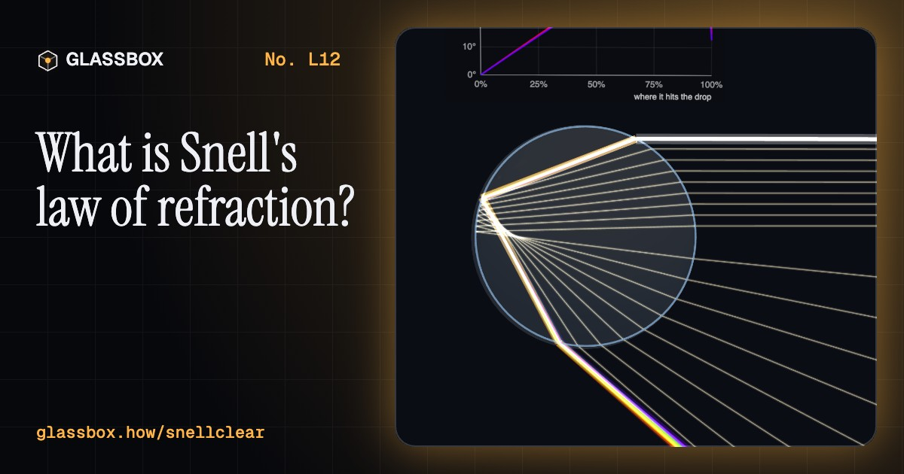
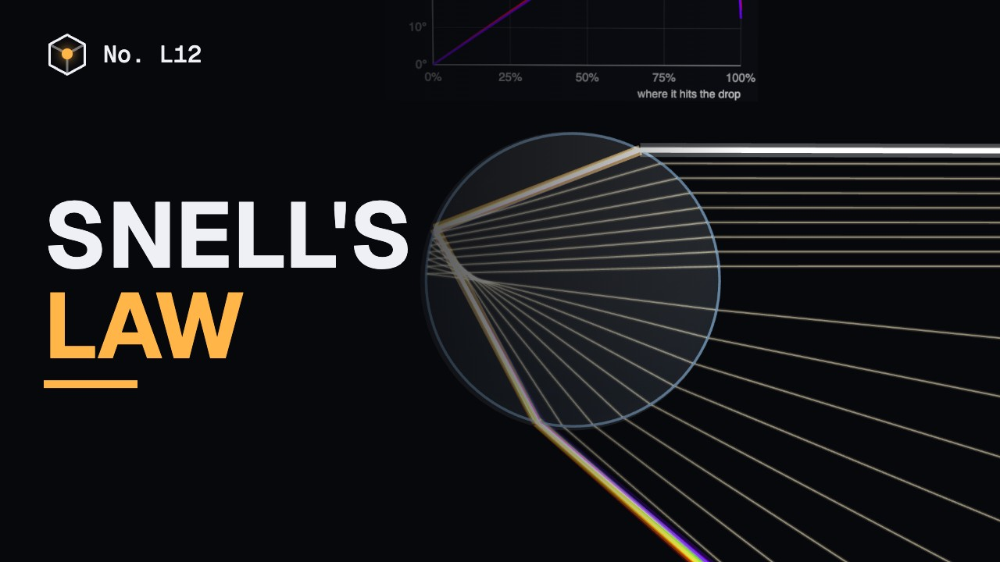
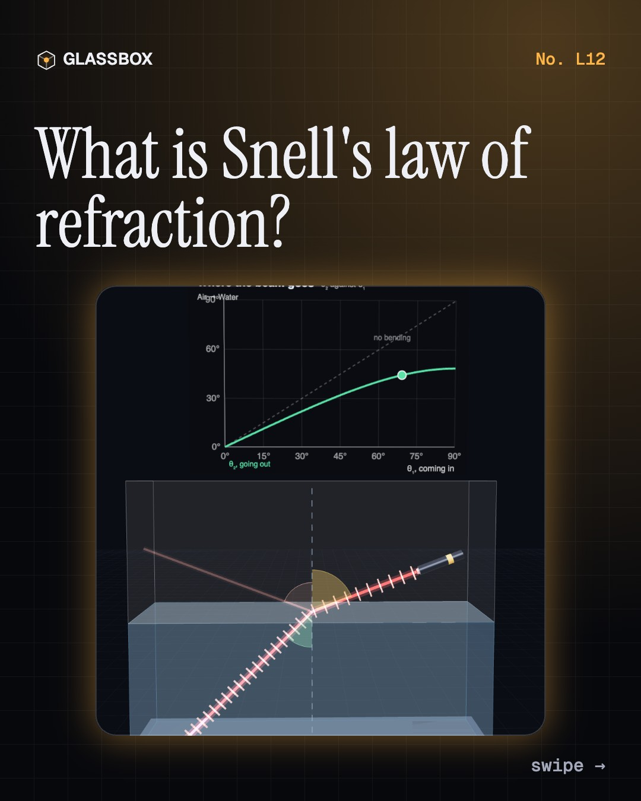
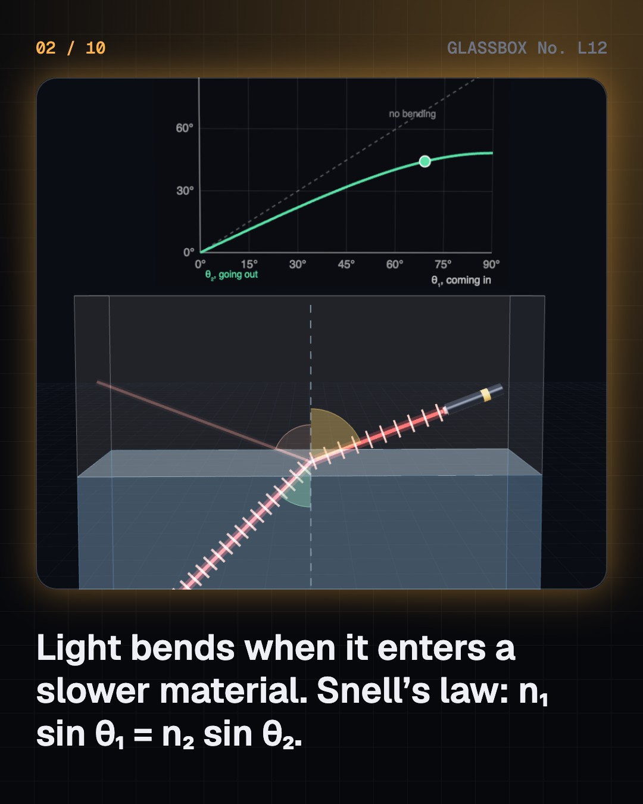
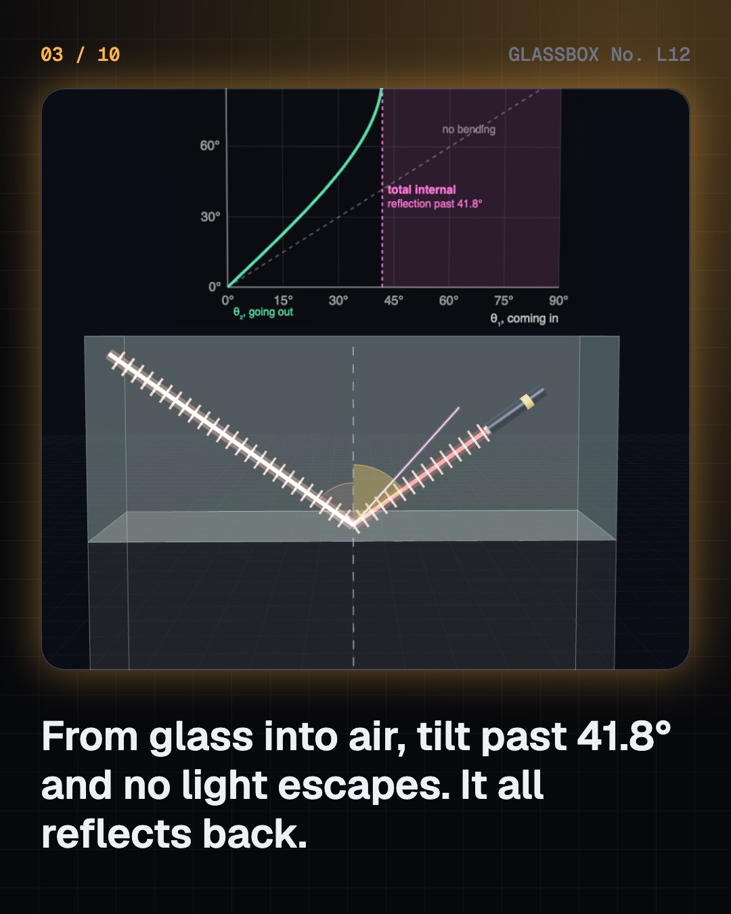
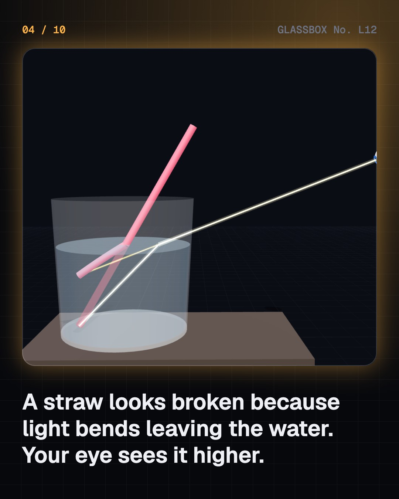

<!-- glassbox:start -->
<!-- Generated from glassbox.json by the Glassbox hub (npm run readme -- snellclear). Edit glassbox.json, not this block. -->
<p align="center"><a href="https://glassbox-production-fd52.up.railway.app/e/snellclear/"></a></p>

<h1 align="center">Snell's law</h1>

<p align="center"><b>What is Snell's law of refraction?</b><br>Why does a straw look broken in a glass of water? Bend a laser across a boundary and watch Snell's law at work, then find the same rule in shallow-looking pools, prisms and rainbows, camera lenses and your own eye, diamonds and the glass fibres of the internet, and the mirage on a hot road.</p>

<p align="center"><a href="https://glassbox-production-fd52.up.railway.app/snellclear/"><b>▶ Play with it</b></a> &nbsp;·&nbsp; <a href="https://glassbox-production-fd52.up.railway.app/e/snellclear/">Read the 60-second explainer</a> &nbsp;·&nbsp; <a href="https://glassbox-production-fd52.up.railway.app/snellclear/glassbox/reel.mp4">Watch the 40-second video</a></p>

<p align="center">
  <a href="https://glassbox-production-fd52.up.railway.app/e/snellclear/"></a>
  <a href="https://glassbox-production-fd52.up.railway.app/e/snellclear/"></a>
  <a href="LICENSE"></a>
  <a href="LICENSE-CONTENT.md"></a>
  <a href="#privacy"></a>
</p>

## In 60 seconds

1. **Light bends when it changes speed.** Every material slows light by a factor n, its refractive index: v = c ÷ n. Crossing into a new material at a slant, the beam turns, by exactly n₁ sin θ₁ = n₂ sin θ₂, with angles measured from the normal.
2. **Your eyes are fooled every day.** Things under water look higher than they are, so straws look broken and pools look three quarters as deep. And because n is a little bigger for violet than for red, prisms and raindrops split white light into colours, with the rainbow at 42°.
3. **Lenses are Snell's law, twice.** Curved glass bends each ray by just the right amount to bring them to one focus. A camera focuses by moving its lens; in your eye the cornea does two thirds of the bending, which is why you can't see clearly under water.
4. **Past the critical angle, light is trapped.** Going into a faster material, beyond sin θc = n₂ ÷ n₁ nothing gets out: total internal reflection, a perfect mirror. It carries the internet down glass fibres, makes diamonds sparkle, and spreads the light in an edge-lit TV.
5. **Mirages, negative index, and a myth.** Hot air over a road curves sky light upwards into a fake puddle. Metamaterials bend light the wrong way. And light doesn't slow by bumping into atoms: shaken electrons re-radiate slightly behind in step, and the sum moves at c ÷ n.

## Words worth knowing

| Term | Meaning |
|---|---|
| **Refraction** | The bending of light as it crosses from one material into another, because its speed changes. |
| **Refractive index (n)** | How many times slower light goes in a material than in a vacuum: air 1.000, water 1.333, glass about 1.5, diamond 2.42. |
| **Normal** | The line at right angles to a surface. Angles in Snell's law are measured from it. |
| **Critical angle** | Going into a faster material, the angle beyond which no light gets out: sin θc = n₂ ÷ n₁. About 42° for glass to air. |
| **Total internal reflection** | All the light reflecting back at a boundary, past the critical angle. It traps light in optical fibres. |
| **Dispersion** | n changing with colour, so violet bends a little more than red. It makes prisms and rainbows. |
| **Focal length** | How far behind a lens parallel rays meet. For a thin lens, 1/f = (n − 1)(1/R₁ − 1/R₂). |
| **Apparent depth** | How deep water looks. Straight down it is the real depth ÷ n, about three quarters. |

## A short history

**From Ptolemy's tables of bent light to glass threads under the ocean, how people learned exactly how much light turns when it crosses into something new.**

- **984** · The true rule, 637 years early (Abu Sa'd al-'Ala' ibn Sahl, Baghdad, Abbasid Caliphate)
- **1621** · Snellius writes down the rule (Willebrord Snellius, Leiden, Dutch Republic)
- **1637** · The sine law is printed, and the rainbow explained (René Descartes, Leiden, Dutch Republic)
- **1662** · Light takes the quickest path (Pierre de Fermat, Toulouse)
- **1678** · Wavelets explain the bend (Christiaan Huygens, Paris)
- **1850** · Light is slower in water (Léon Foucault; Hippolyte Fizeau and Louis Breguet, Paris)
- **1954** · A picture carried along glass threads (Harold Hopkins and Narinder Singh Kapany, Imperial College, London)
- **1966** · Glass could carry the world's messages (Charles Kao and George Hockham, Standard Telecommunication Laboratories, Harlow)

The full story, with 20 moments, charts, people and 41 sources: [glassbox.how/e/snellclear/history](https://glassbox-production-fd52.up.railway.app/e/snellclear/history/). The data lives in [`history.json`](history.json).

## Video and slides

Made with the Glassbox studio from this box's storyboard (`window.glassbox.director`). Free to reuse under CC BY 4.0.

<a href="https://glassbox-production-fd52.up.railway.app/snellclear/glassbox/video.mp4"></a>

<p><a href="glassbox/slide-1.jpg"></a> <a href="glassbox/slide-2.jpg"></a> <a href="glassbox/slide-3.jpg"></a> <a href="glassbox/slide-4.jpg"></a></p>

| File | What | Size |
|---|---|---|
| [`glassbox/reel.mp4`](https://glassbox-production-fd52.up.railway.app/snellclear/glassbox/reel.mp4) | Reel / Short, with captions and soundtrack | 1080×1920 |
| [`glassbox/video.mp4`](https://glassbox-production-fd52.up.railway.app/snellclear/glassbox/video.mp4) | YouTube video, with captions and soundtrack | 1920×1080 |
| `glassbox/slide-1…10.jpg` | Instagram carousel | 1080×1350 |
| `glassbox/thumb.jpg` | YouTube thumbnail | 1280×720 |
| `glassbox/cover.jpg` | Share card and repo social preview | 1200×630 |
| [`glassbox/history-reel.mp4`](https://glassbox-production-fd52.up.railway.app/snellclear/glassbox/history-reel.mp4) | “History in 10 moments” Reel / Short | 1080×1920 |
| `glassbox/history-slide-*.jpg` | History carousel | 1080×1350 |
| `glassbox/post.json` | Post copy and schedule used by the publish kit | |

## Privacy

This box has no accounts and no ads, and it ships its own fonts and libraries. When you run it yourself it sends nothing anywhere. On glassbox.how, the site's `/bar.js` also loads Glassbox's analytics: **Google Analytics** to count visits (it asks first in the EU, UK and Switzerland, and stays off when your browser sends Global Privacy Control or Do Not Track) and **ClickTrust** to detect bots.

It remembers a few things **in your own browser only**, and never sends them anywhere:

| Browser storage key | What it holds |
|---|---|
| `snellclear.v1` | Which chapters you have opened, your best quiz scores, and sound on or off. |

Exactly what each one sees is at [glassbox.how/privacy](https://glassbox-production-fd52.up.railway.app/privacy/).

## Licences

- **Code:** [MIT](LICENSE). Use it, change it, ship it.
- **Explanations, text, images and videos** (`glassbox.json`, `glassbox/`): [CC BY 4.0](LICENSE-CONTENT.md). Credit “Glassbox, glassbox.how/e/snellclear”.
- **Third-party parts** keep their own licences: [three.js](https://threejs.org) (MIT), [Geist, Instrument Serif](https://openfontlicense.org) (SIL OFL 1.1).
- The Glassbox name and logo aren't covered by either licence. See the [terms](https://glassbox-production-fd52.up.railway.app/terms/).

Found a mistake? [Open an issue](https://github.com/bdeeps/snellclear/issues). Corrections happen in public.
<!-- glassbox:end -->

## Run it

It's plain HTML, CSS and JavaScript. No build step and no dependencies. Run locally, it contacts no other website.

```bash
python3 -m http.server 8000
```

Three.js and the fonts ship in `vendor/` and `fonts/`, so it also works offline.

Then open http://localhost:8000.

## How it's built

| File | What |
|---|---|
| `index.html`, `css/app.css` | The page and its styles |
| `js/app.js`, `js/stage.js`, `js/ui.js`, `js/kit.js` | The shared Glassbox 3D engine: chapters, 3D stage, controls, quiz, video director |
| `js/chapters/*.js` | One file per chapter: the 3D model, controls, text, key terms, quiz and video scenes |
| `js/snell.js` | Optics shared by the chapters: refractive indices and dispersion, Snell's law and Fresnel reflection, a 2D ray tracer for prisms, gems and fibres, an exact lens tracer, chart boards and glowing laser rays |
| `glassbox.json` | Title, question, explainer beats, key terms, browser storage and credits shown on glassbox.how |
| `reel` in each chapter | The storyboard the Glassbox studio records into short videos |
| `glassbox/` | The published video, slides, thumbnail and post copy |
| `fonts/`, `vendor/three/` | Self-hosted Geist and Instrument Serif (SIL OFL 1.1) and three.js (MIT) |
